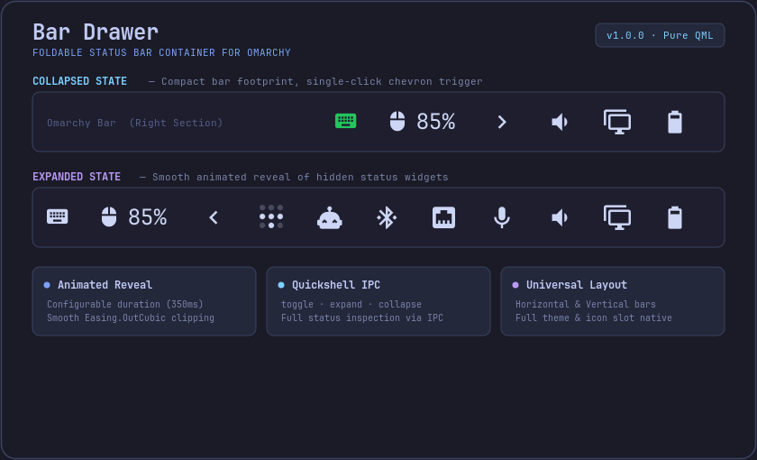

# Bar Drawer for Omarchy

A polished, native Omarchy status bar container widget that neatly folds secondary or infrequently used status widgets into a compact, animated drawer.

<p align="center">
  <b>Foldable Widget Drawer</b> • <b>Smooth Animated Reveal</b> • <b>Quickshell IPC Controls</b> • <b>Orientation Native</b>
</p>

<p align="center">
  
</p>

---

## Features

- **Foldable Status Widget Container**:
  - Encapsulates any number of status bar widgets (network, bluetooth, tailscale, agents, microphones, custom plugins) into an expandable drawer.
  - Keeps your status bar clean and minimalist during deep work while keeping essential status monitors one click away.
- **Smooth Animated Reveal**:
  - High-performance, hardware-accelerated clipping and sliding reveal with configurable animation duration and easing (`Easing.OutCubic`).
  - Fluid width/height transition that smoothly repositions adjacent status bar items without jitter.
- **Intelligent Popout Coordination**:
  - Automatically expands the drawer when a nested child widget's popout is opened.
  - Cleanly dismisses open child popouts when the drawer collapses.
- **Quickshell IPC Controls**:
  - Full external script and hotkey control via Quickshell IPC (`toggle`, `expand`, `collapse`, `status`).
  - Supports binding drawer toggling to Hyprland hotkeys or automated shell scripts.
- **Universal Bar Orientation**:
  - Supports both horizontal top/bottom bars and vertical left/right bars with automatic rotation and alignment.
- **Native Theme & Style Integration**:
  - Inherits Omarchy system palettes, colors, icon slot sizing, spacing, and hover states with zero custom styling hacks.

---

## Installation and Removal

### Using Omarchy Plugin Manager

Install directly via the Omarchy plugin CLI:

```bash
omarchy plugin add git@github.com:nertwork/omarchy-drawer.git --enable
```

Or via HTTPS:

```bash
omarchy plugin add https://github.com/nertwork/omarchy-drawer.git --enable
```

### Manual Installation

Clone directly into your Omarchy plugins directory:

```bash
git clone https://github.com/nertwork/omarchy-drawer.git ~/.config/omarchy/plugins/nertwork.drawer
```

### Updating

```bash
omarchy plugin update nertwork.drawer
```

### Removal

```bash
omarchy plugin remove nertwork.drawer
```

---

## Configuration Reference

Add `nertwork.drawer` to `bar.layout.right`, `bar.layout.left`, or `bar.layout.center` in `~/.config/omarchy/shell.json`:

```json
{
  "id": "nertwork.drawer",
  "defaultExpanded": false,
  "chevronPosition": "left",
  "animationDuration": 350,
  "items": [
    "omarchy.tailscale",
    "nertwork.agents",
    "omarchy.bluetooth",
    "omarchy.network",
    "omarchy.microphone"
  ]
}
```

### Configuration Options

| Option | Type | Default | Description |
|---|---|---|---|
| `items` | `Array<string \| object>` | `["omarchy.tailscale", "nertwork.agents", "omarchy.bluetooth", "omarchy.network", "omarchy.microphone"]` | List of widget IDs or widget definition objects to nest inside the drawer. |
| `defaultExpanded` | `boolean` | `false` | Whether the drawer starts in the expanded state when Omarchy Shell loads. |
| `chevronPosition` | `string` | `"left"` | Position of the expansion chevron relative to the contained widgets: `"left"` or `"right"`. |
| `animationDuration` | `number` | `350` | Duration of the expand/collapse reveal animation in milliseconds (50ms – 2000ms). |

---

## IPC Interface Reference

Bar Drawer exposes a full Quickshell IPC interface under the target `nertwork.drawer`. You can invoke actions from terminal scripts, shell hooks, or window manager shortcuts.

### Quickshell IPC Commands

```bash
# Toggle drawer expansion state
quickshell ipc -p /usr/share/omarchy/shell call nertwork.drawer toggle

# Expand drawer
quickshell ipc -p /usr/share/omarchy/shell call nertwork.drawer expand

# Collapse drawer
quickshell ipc -p /usr/share/omarchy/shell call nertwork.drawer collapse

# Query detailed JSON status (dimensions, loaded widgets, visibility)
quickshell ipc -p /usr/share/omarchy/shell call nertwork.drawer status
```

### Hyprland Keybinding Example

Add a shortcut to `~/.config/hypr/hyprland.conf` to toggle the drawer with your keyboard:

```ini
bind = $mainMod, D, exec, quickshell ipc -p /usr/share/omarchy/shell call nertwork.drawer toggle
```

---

## Controls

| Input | Action |
|---|---|
| **Left-Click (Chevron)** | Toggle drawer expand / collapse locally on the clicked monitor |
| **Right-Click (Chevron)** | Broadcast toggle across all connected displays |

---

## License

MIT License. See [LICENSE](LICENSE) for details.
